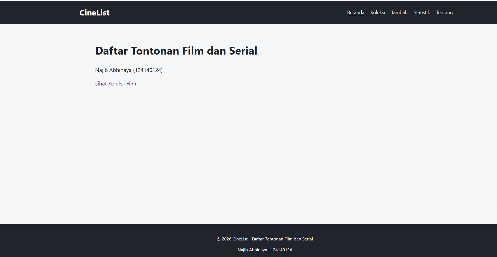

# Daftar Tontonan Film dan Serial

Nama: Najib Abhinaya
NIM: 124140124
Kelas: RB
Tema: Daftar Tontonan Film dan Serial
Deployment: https://abhinayann.github.io/uts-paw/



## Fitur

- Beranda (/): judul aplikasi, nama + NIM dari           mahasiswa.json, tautan ke koleksi
- Koleksi (/koleksi): daftar film/serial, pencarian berdasarkan judul (tidak peka huruf besar/kecil), pesan “tidak ditemukan”, status loading/error
- Detail (/koleksi/:id): info lengkap satu tontonan, tombol Hapus, lalu diarahkan balik ke koleksi
- Tambah (/tambah): form judul, kategori, sutradara, tahun, rating, dengan validasi judul wajib
- Statistik (/statistik): jumlah Film, Serial, total, 3 tambahan terbaru, tabel ringkasan
- Tentang (/tentang): deskripsi aplikasi dan identitas mahasiswa
- Panduan (/panduan): cara pemakaian aplikasi
- 404 (*): halaman untuk rute yang tidak dikenal

## Menjalankan secara lokal

cd app
npm install
npm run dev

## Konsep React yang dipakai

- Dasar: function component, JSX, Fragment, StrictMode, render list dengan map() + key, conditional rendering
- State dan event: useState, controlled component, onSubmit + preventDefault(), derived data, update state immutable
- Side effect: useEffect (fetch data saat mount dan sinkronisasi ke localStorage), async/await dengan state loading/error
- Context API: createContext, FilmProvider, custom hook useFilm(), prop children
- React Router: BrowserRouter + basename, Routes/Route (dynamic :id dan wildcard *), Link/NavLink, useParams, useNavigate
- Tooling: Vite, Vitest + React Testing Library, gh-pages
```
